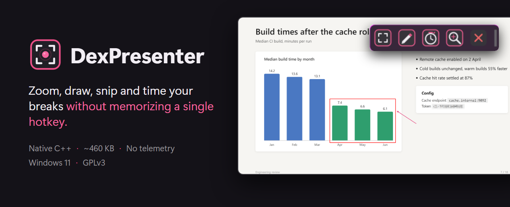
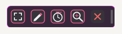
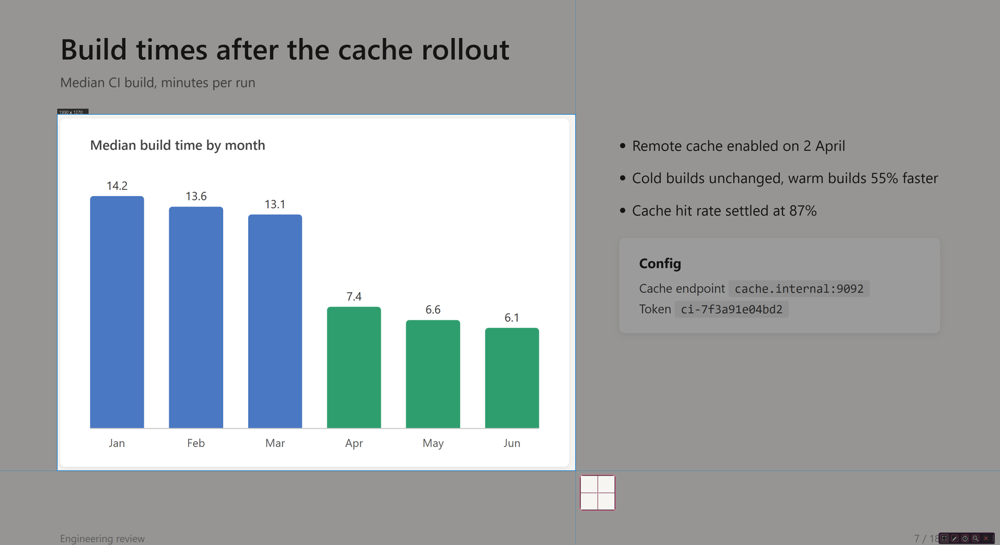
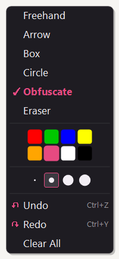
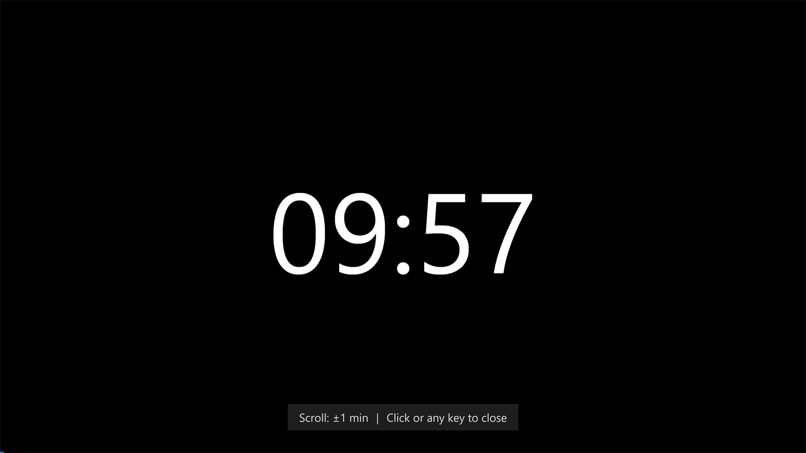

# DexPresenter

DexPresenter is a small presentation tool for Windows 11: under 500 KB, no telemetry, no dependencies. It is inspired by [ZoomIt](https://learn.microsoft.com/en-us/windows/powertoys/zoomit) and gives you screen zoom, drawing annotations, a break timer and screen snipping from a small always-on-top toolbar.

Every tool and setting is on the toolbar or a right-click panel, so you don't need to remember hotkeys in the middle of a talk.

> **Alpha.** This project is in early development. Expect breaking changes, missing features, and rough edges.

DexPresenter is built and maintained by one developer in their spare time, someone who kept forgetting ZoomIt's hotkeys. No company or team is behind it.

It has no ads, collects no telemetry or user data, and never talks to a server. Everything it needs is in `Program Files\DexPresenter` and `%AppData%\DexPresenter`. [A CI guard](.github/workflows/security-guards.yml) fails the build if any networking API appears in the shipped code. See [PRIVACY.md](docs/PRIVACY.md).

## Key information

- Status: Alpha
- Technology: Native C++23 (Win32 API)
- Executable size: ~460 KB
- Platform: Windows 11
- License: GPLv3

## Tools

All tools sit in one small toolbar that stays in front of every other window. Drag it anywhere, on any monitor, and it stays out of the way of your slides.

| Tool  | Description                                                                                                        |
| ----- | ------------------------------------------------------------------------------------------------------------------ |
| Snip  | Rectangle screen selection. Saves to clipboard and PNG file.                                                       |
| Draw  | Capture screen, draw annotations. Right-click for tool/color/width panel. Auto-saves annotated screenshot on exit. |
| Timer | Full-screen countdown timer (default 10 minutes). Scroll to add or remove a minute, click or press any key to close. |
| Zoom  | Capture screen, overlay zoomed view. Mouse to pan, scroll to zoom, ESC to exit.                                    |

  
  &nbsp;
  
  &nbsp;
  

The drawing modes, toolbar behavior and screenshot saving are described in [FEATURES.md](docs/FEATURES.md). Settings and `config.ini` are in [CONFIGURATION.md](docs/CONFIGURATION.md).

## Installation

### Installer (recommended)

Download and run the installer from the [Releases page](https://github.com/guHe330/DexPresenter/releases). DexPresenter has no commercial code-signing certificate, so Windows SmartScreen may warn on first run. Click **More info**, then **Run anyway**. To check the download first, see [VERIFYING.md](docs/VERIFYING.md).

The installer puts the complete source code (`DexPresenter_Sources.zip`) in the installation directory, so you can inspect, modify or rebuild the application under the GPLv3.

### Manual installation

1.  Download `DexPresenter.exe` from the latest release.
2.  Place it anywhere (e.g. `C:\Program Files\DexPresenter\`).
3.  Run `DexPresenter.exe`. The toolbar appears at the top edge of your screen.

## Documentation

- [Features](docs/FEATURES.md)
- [Configuration](docs/CONFIGURATION.md)
- [Verifying a download](docs/VERIFYING.md)
- [Building](docs/BUILDING.md)
- [Changelog](docs/CHANGELOG.md)
- [Privacy](docs/PRIVACY.md)
- [Security](SECURITY.md)
- [Support](docs/SUPPORT.md)
- [Contributing](docs/CONTRIBUTING.md)

## Issues

Bug reports are appreciated, and test reports from multi-monitor and mixed-DPI setups most of all: the [multi-monitor / DPI test report](https://github.com/guHe330/DexPresenter/issues/new?template=multi_monitor_report.yml) takes five minutes.

- [Open bugs](https://github.com/guHe330/DexPresenter/issues?q=is%3Aissue+label%3Abug)
- [Feature requests](https://github.com/guHe330/DexPresenter/issues?q=is%3Aissue+label%3Aenhancement)

## Project Scope

DexPresenter is built primarily for my own presentations. Feature requests and pull requests are welcome, but changes that do not fit that direction may be declined.

Please open an issue before implementing larger changes.

Forks are welcome; that's what the GPL is for.

## License

DexPresenter is licensed under the GPLv3. See [LICENSE](LICENSE).

The application icon and image assets (`resources/DexPresenter.ico` and `resources/icons/`) are not covered by the GPLv3. They remain proprietary to Gunter Heiss under separate terms; see [resources/ICON_LICENSE.txt](resources/ICON_LICENSE.txt). If you fork or redistribute DexPresenter, replace them with your own artwork.

Third-party components and their licenses are listed in [THIRD_PARTY_NOTICES.txt](THIRD_PARTY_NOTICES.txt).
