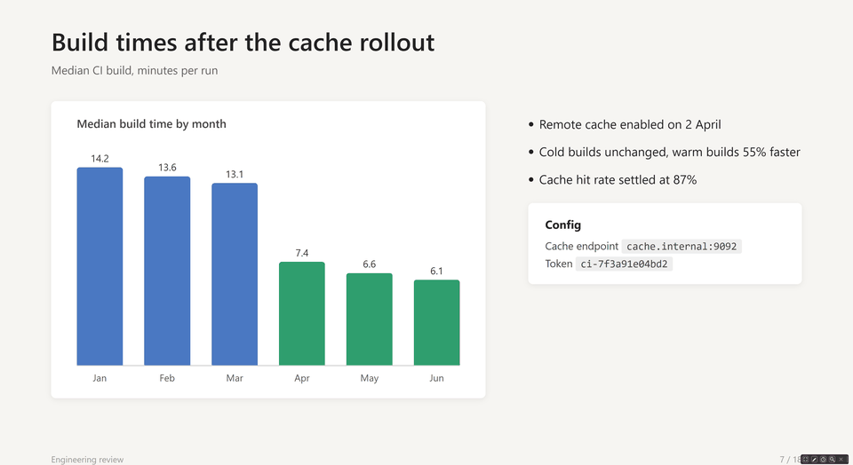
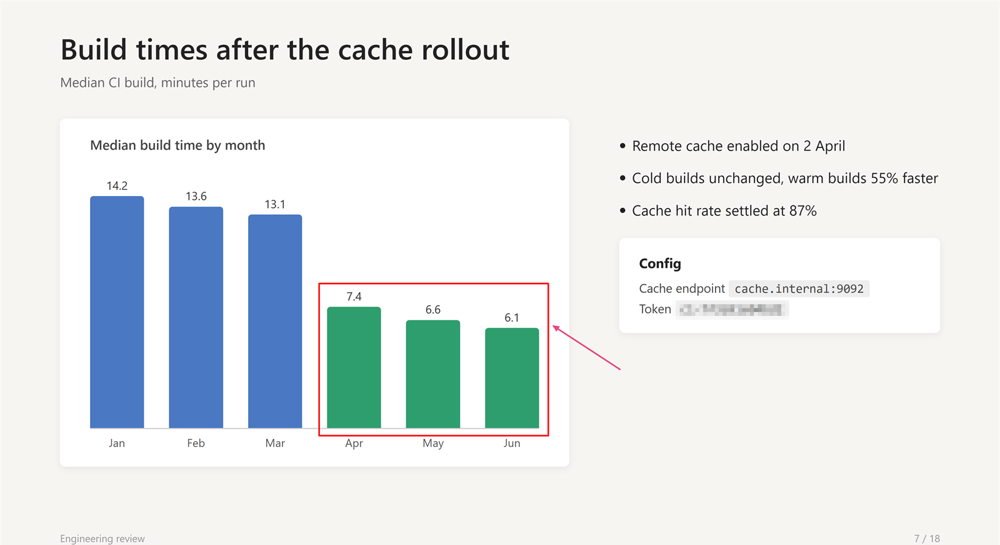

# DexPresenter features

## Tools

| Tool  | Description                                                                                                        |
| ----- | ------------------------------------------------------------------------------------------------------------------ |
| Snip  | Rectangle screen selection. Saves to clipboard and PNG file.                                                       |
| Draw  | Capture screen, draw annotations. Right-click for tool/color/width panel. Auto-saves annotated screenshot on exit. |
| Timer | Full-screen countdown timer (default 10 minutes). Scroll to add or remove a minute, click or press any key to close. |
| Zoom  | Capture screen, overlay zoomed view. Mouse to pan, scroll to zoom, ESC to exit.                                    |

<!-- TODO gif: snip tool — dragging a rectangle selection, showing the saved result -->

## Drawing

Right-click while drawing to open the panel. It has six shape modes (Freehand, Arrow, Box, Circle, Obfuscate, Eraser), 8 colors, 4 pen widths, and Clear All. Each shape mode remembers its own color and width across sessions.

- Obfuscate pixelates the region you drag over, for hiding email addresses, passwords and similar.
- Eraser removes the elements you drag over. Erasing can be undone like any other action.
- Ctrl+Z undoes the last action, Ctrl+Y redoes it.
- Hold Shift for perfect squares (Box) or circles (Circle).

## Toolbar and settings

The toolbar is a small always-on-top window with Snip, Draw, Timer and Zoom buttons and a close button. It uses a dark plum and pink theme, rendered with anti-aliased GDI+.

Drag the grip to move it. The toolbar always stays fully on screen and moves freely between monitors. It snaps flush against the taskbar; drag a few pixels further and it floats over the taskbar instead. It remembers where you put it on each monitor, across restarts.

The tray icon's right-click menu has Show Toolbar, Settings and Exit. Settings opens a tabbed dialog for the zoom level, timer duration, screenshot folder and Start with Windows. See [CONFIGURATION.md](CONFIGURATION.md).

<!-- TODO screenshot: settings dialog showing the zoom/timer tabs -->
<!-- TODO screenshot: system tray icon with right-click context menu -->

## Screenshots

Snip saves a PNG as soon as you capture. Draw saves the annotated screenshot when you exit. Files go to `%USERPROFILE%\Pictures\DexPresenter` unless you pick another folder on the General tab of the settings, and are named with a timestamp, for example `DexPresenter_Draw_2026-03-05T14-30-45.png`.

## Size and speed

DexPresenter is native C++ on the Win32 API. The executable is about 460 KB, including its icons, and has no external dependencies because the C runtime is linked statically. There is no managed runtime or JIT, so it starts instantly.
